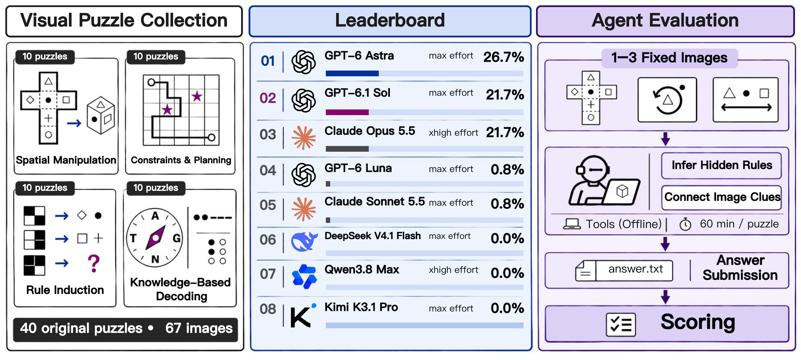
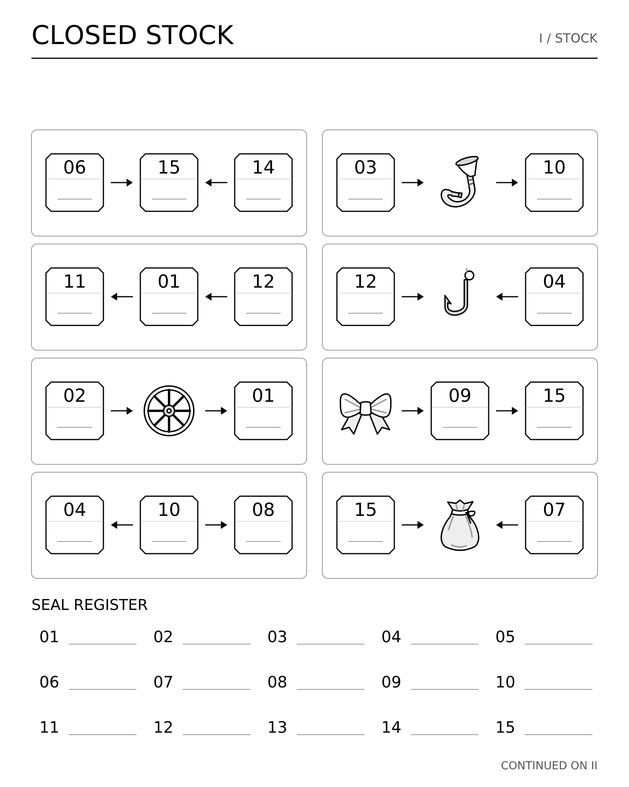

<div align="center">

# Visual Cipher Bench

**Benchmarking LLM agents on long-horizon visual reasoning.**

[](https://arxiv.org/abs/2611.16861)
[](https://lab.einsia.ai/visual-cipher-bench/)
[](https://github.com/Einsia/Visual-Cipher-Bench)
[](https://lab.einsia.ai/visual-cipher-bench/#leaderboard)

</div>

[](docs/assets/framework.pdf)

## What it is

Visual Cipher Bench asks whether an agent can discover a puzzle's rules from images and carry out the reasoning needed to solve it. The benchmark contains **40 original visual puzzles and 67 images**, organized into four categories of ten tasks. Each task provides one to three black-and-white drawings and the same short submission instruction. The mechanism, examples, and clues must be inferred from the images.

Agents have **60 minutes**, **2 CPUs**, and **4 GB RAM** per task. They can inspect images and run code in an offline container, but receive no answer-correctness feedback while solving. A separate deterministic verifier scores the final answer; there is no model judge.

## Tasks

| Category | Main challenge | Tasks |
| --- | --- | ---: |
| [P1 · Spatial manipulation and simulation](tasks/spatial-reasoning) | Infer the result of folds, rotations, projections, and other spatial operations. | 10 |
| [P2 · Logical constraints and planning](tasks/logic-puzzles) | Recover visual constraints and work through a consistent plan or configuration. | 10 |
| [P3 · Rule induction](tasks/rule-induction) | Infer a puzzle-specific transformation or cipher from visual examples. | 10 |
| [P4 · Knowledge-based decoding](tasks/knowledge-decoding) | Recognize the convention or linguistic relationship indicated by the drawings. | 10 |

See the [complete task index](tasks/README.md) for all 40 task IDs and image counts.

<details>
<summary>Example input: Closed Stock, page 1 of 2</summary>



The agent receives both images. Its instruction does not explain the mechanism. The reference walkthrough and solver are in the task's `solution/` directory and contain spoilers.

</details>

## Quickstart

Use a Linux `amd64` host with Docker and Python 3.12. ARM hosts need `amd64` emulation; some reference solvers contain Linux binaries.

```bash
git clone git@github.com:Einsia/Visual-Cipher-Bench.git
cd Visual-Cipher-Bench
python3.12 -m venv .venv
. .venv/bin/activate
python -m pip install harbor==0.24.0
bash scripts/build_base_image.sh

# Check one reference solution without calling a model API.
harbor run -p tasks/spatial-reasoning/prism-camera -a oracle -n 1
```

The build downloads pinned dependencies and checks their SHA-256 hashes. It installs Codex `0.163.0`, its matching code-mode host, and Claude Code `2.1.296` before the offline task runs. See [setup and agent commands](docs/SETUP.md) for credentials, gateway configuration, full-corpus runs, and troubleshooting.

## Repository layout

```text
tasks/<category>/<task-id>/  Images, task configuration, reference solution, verifier
docs/                       Setup, schema, evaluation protocol, checksums
infra/docker/               Shared runtime image and build context
scripts/                    Base-image build entry point
```

The task folders use the [Harbor](https://harborframework.com) format. `solution/` and `tests/` contain reference answers and must stay outside the evaluated agent's filesystem. Only `environment/` is used as a task-image build context.

## Documentation and contribution

- [Setup and troubleshooting](docs/SETUP.md)
- [Task schema and visibility boundaries](docs/SCHEMA.md)
- [Scoring and evaluation protocol](docs/EVALUATION.md)
- [Runtime infrastructure](infra/README.md)
- [Contribution guide](CONTRIBUTING.md)
- [Third-party notices](THIRD_PARTY_NOTICES.md)

## Citation

```bibtex
@article{hong2026visualcipherbench,
  title   = {Visual Cipher Bench: Benchmarking LLM Agents on Long-Horizon Visual Reasoning},
  author  = {Deyao Hong and Jiayi Jiang and Yuchun Chen and Yixuan Shi and Wenyi Li
             and Zheng Jiang and Chengxing Xie and Mingyu Su and Qingle Liu and Mingju Gao
             and Yizhe Chi and Youjie Zheng and Calvin Xiao and Kaisen Yang
             and Huan-ang Gao},
  journal = {arXiv preprint arXiv:2611.16861},
  year    = {2026}
}
```

## License

- **Project code and technical documentation.** Project-authored solvers, graders, task configuration, scripts, Dockerfiles, and technical documentation are licensed under [Apache-2.0](LICENSE).
- **Puzzle content.** Original task images, instructions, reference answers, and written walkthroughs for which the project can grant those rights are licensed under [CC BY 4.0](LICENSE-CONTENT).
- **Third-party material.** Bundled fonts, dictionaries, derived word lists, native libraries, and third-party marks follow their respective terms. See [NOTICE](NOTICE) and [THIRD_PARTY_NOTICES.md](THIRD_PARTY_NOTICES.md) for the scope and attribution records.
